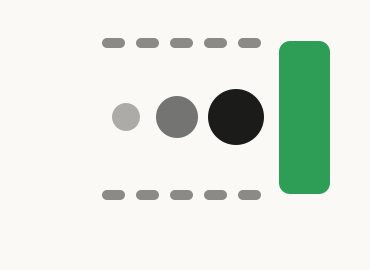

<div align="center">
  <picture>
    <source media="(prefers-color-scheme: dark)" srcset="assets/rushlane-mark-dark.svg">
    
  </picture>
  <h1>Rushlane: Simulasi Kejadian Diskrit untuk Antrean Kantin</h1>
  <p><b>Simulasikan perilaku antrean kantin kampus, bandingkan satu baris bersama dengan baris per kasir,<br/>
  dan temukan jumlah kasir terkecil yang memenuhi target layananmu.</b></p>

  <a href="https://github.com/nekonaru/rushlane/releases"></a>
  <a href="https://github.com/nekonaru/rushlane/actions/workflows/ci.yml"></a>
  
  
  
  
</div>

<br />

[English](README.md) | **Bahasa Indonesia**

> [!NOTE]
> Rushlane membutuhkan Julia 1.10 atau yang lebih baru. Semua kebutuhan lain diresolusi dan dipasang otomatis oleh package manager Julia saat kamu meng-instantiate proyek.

---

## Daftar Isi

- [Tentang](#tentang)
- [Fitur](#fitur)
- [Kebutuhan](#kebutuhan)
- [Instalasi](#instalasi)
- [Pemakaian](#pemakaian)
- [Konfigurasi](#konfigurasi)
- [Struktur Proyek](#struktur-proyek)
- [Pengembangan](#pengembangan)
- [Pengujian](#pengujian)
- [Keamanan](#keamanan)
- [Integrasi Berkelanjutan](#integrasi-berkelanjutan)
- [FAQ](#faq)
- [Penulis](#penulis)
- [Lisensi](#lisensi)

---

## Tentang

**Rushlane** adalah simulasi kejadian diskrit untuk antrean kantin kampus, dibangun untuk menjawab satu pertanyaan: berapa kasir yang sebenarnya kamu butuhkan? Simulasi ini memodelkan lonjakan kedatangan tidak seragam (jam makan siang), distribusi waktu layanan yang bisa dikonfigurasi, satu baris bersama dibandingkan baris per kasir, dan pelanggan yang menyerah saat antrean terlalu panjang. Jalankan skenario bawaan dan baca laporan berisi persentil waktu tunggu, panjang antrean, utilisasi, perkiraan penjualan hilang, dan rekomendasinya.

> _"Antrean pendek, kasir penuh, tanpa tebak-tebakan."_

---

## Fitur

### Mesin simulasi

| Fitur | Deskripsi |
|---------|-------------|
| **Mesin kejadian diskrit** | Event loop min-heap tulis tangan dengan event kedatangan, mulai layanan, selesai, dan renege; tanpa library simulasi |
| **Kedatangan tidak seragam** | Proses Poisson non-homogen dengan laju per bin (default 15 menit), ditambah faktor skala global untuk hari ramai (misal ujian) |
| **Layanan yang bisa diatur** | Distribusi waktu layanan per tipe (`lognormal`, `gamma`, `exponential`, `normal`, `constant`) dengan mean dan koefisien variasi |
| **Dua mode antrean** | Satu baris FIFO bersama, atau satu baris per kasir dengan pemilihan baris terpendek |
| **Balking** | Pelanggan tidak jadi mengantre jika sudah terlalu banyak yang menunggu |
| **Reneging** | Pelanggan keluar antrean setelah kesabarannya (eksponensial) habis |
| **Shift kasir** | Jumlah kasir berbeda per jendela waktu (misal 2 pagi, 5 saat makan siang) |

### Analisis dan laporan

| Fitur | Deskripsi |
|---------|-------------|
| **Replikasi** | Replikasi yang bisa diatur (default 200) dengan seed tetap; mean dengan interval kepercayaan 95% berbasis t |
| **Validasi Erlang C** | Rumus M/M/c bawaan untuk memvalidasi mesin dalam kondisi stasioner |
| **Optimizer** | Mencari jumlah kasir terkecil yang memenuhi SLA (P90 tunggu, tingkat batal) dan membandingkan biaya harian (gaji vs penjualan hilang) |
| **Laporan satu perintah** | `julia --project=. scripts/rushlane.jl` menulis laporan Markdown, ekspor CSV, dan tiga grafik ke folder `out/` |
| **Visualisasi** | Panjang antrean sepanjang hari, histogram waktu tunggu, dan kurva tunggu/batal terhadap jumlah kasir |
| **Reproducible** | RNG terkontrol seed, common random numbers lintas skenario, `Manifest.toml` terkunci (Julia 1.10 LTS) |

---

## Kebutuhan

| Dependensi | Versi Minimum | Catatan |
|------------|-----------------|-------|
| **Julia** | 1.10 | LTS. Versi 1.x yang lebih baru juga bisa |
| **Git** | versi terbaru | untuk clone dan update repositori |

> [!TIP]
> Belum punya Julia? Cara termudah adalah installer resmi dari https://julialang.org/downloads/. Di Windows, `winget install Julia` juga bisa.

### Belum pernah pakai terminal? Mulai di sini

<details><summary><b>Membuka terminal</b></summary>

**Windows:** tekan tombol Start, ketik `powershell`, tekan Enter.

**macOS:** tekan `Cmd + Space`, ketik `terminal`, tekan Enter.

**Linux (GNOME):** tekan `Ctrl + Alt + T`.

</details>

---

## Instalasi

### Opsi A: Tambahkan ke environment Julia (tercepat)

1. Buka terminal dan mulai Julia:

   ```bash
   julia
   ```

2. Tambahkan Rushlane langsung dari GitHub:

   ```julia
   using Pkg
   Pkg.add(url="https://github.com/nekonaru/rushlane.git")
   ```

3. Verifikasi bisa dimuat:

   ```julia
   using Rushlane
   ```

### Opsi B: Build dari source (untuk pengembangan / membaca atau mengubah kode)

#### 1. Ambil kodenya

<details><summary><b>Saya sudah punya Git</b></summary>

```bash
git clone https://github.com/nekonaru/rushlane.git
cd rushlane
```

</details>

<details><summary><b>Saya belum punya Git</b></summary>

1. Buka https://github.com/nekonaru/rushlane
2. Klik **Code**, lalu **Download ZIP**
3. Ekstrak, lalu buka terminal di dalam folder hasil ekstraksi

</details>

#### 2. Pasang dependensi dan verifikasi

> [!IMPORTANT]
> `Manifest.toml` yang di-commit menargetkan Julia 1.10 LTS agar instalasi bit-for-bit identik. Di Julia 1.12 atau lebih baru, hapus `Manifest.toml` sebelum instantiate; resolver akan memilih versi yang kompatibel untuk Julia kamu.

```bash
julia --project=. -e 'using Pkg; Pkg.instantiate()'
julia --project=. -e 'using Rushlane; println("Rushlane loaded")'
```

#### 3. Jalankan test suite

```bash
julia --project=. -e 'using Pkg; Pkg.test()'
```

---

## Pemakaian

### Pertama kali

1. Pasang proyeknya (lihat di atas).
2. Buat laporan lengkap dengan konfigurasi contoh bawaan:

   ```bash
   julia --project=. scripts/rushlane.jl
   ```

3. Buka `out/report.md` di Markdown viewer mana pun. Grafik dan file CSV ekspor ada di folder yang sama.

### Sehari-hari

- **Ukur kantinmu.** Edit `config/kantin_default.toml`: hitung pelanggan tiap 15 menit selama seminggu, stopwatch waktu layanan, lalu isi `rates_per_hour` dan mean layanan.
- **Coba hari ramai.** Atur `[arrivals] scale = 1.2` untuk hari 20% lebih sibuk tanpa mengubah profil.
- **Bandingkan mode antrean.** Ubah `[queue] mode` antara `single` dan `per_server`, lalu jalankan lagi.
- **Modelkan staffing makan siang.** Tambahkan blok `[[shifts]]`, misal 2 kasir sebelum 11:30, 5 saat makan siang, 2 setelahnya.
- **Tanya pertanyaanmu sendiri.** Ubah `[sla]` sesuai target; laporan akan menunjukkan jumlah kasir termurah yang memenuhinya.

```bash
julia --project=. scripts/rushlane.jl path/to/kantin_saya.toml --out out/laporan_saya
```

---

## Konfigurasi

Semua konfigurasi berada di satu file TOML (lihat `config/kantin_default.toml` dengan komentar Bahasa Indonesia). Pengaturan utama:

| Seksi | Kunci | Mengatur |
|---------|------|-------------------|
| `[sim]` | `open`, `close` | Jendela simulasi, HH:MM |
| `[sim]` | `replications`, `seed` | Jumlah replikasi dan seed dasar |
| `[arrivals]` | `bin_minutes`, `rates_per_hour` | Pelanggan per jam per bin, mulai jam buka |
| `[arrivals]` | `scale` | Pengali global (1.0 = normal, 1.2 = minggu ujian) |
| `[service.*]` | `share`, `dist`, `mean_seconds`, `cv` | Distribusi waktu layanan per tipe pelanggan |
| `[queue]` | `mode` | `single` (satu baris) atau `per_server` (satu baris per kasir) |
| `[behavior]` | `balk_queue_length`, `patience_mean_minutes` | Ambang balking, rata-rata kesabaran |
| `[servers]` | `count` | Jumlah kasir konstan |
| `[[shifts]]` | `from`, `to`, `count` | Jumlah kasir per jendela waktu (opsional) |
| `[sla]` | `p90_wait_minutes`, `max_abandon_percent` | Target layanan yang dipakai optimizer |
| `[cost]` | `cashier_per_hour`, `lost_customer_cost` | Input perbandingan biaya harian |
| `[report]` | `max_servers` | Jumlah kasir terbesar yang dievaluasi (default 8) |

---

## Struktur Proyek

```
rushlane/
├── Project.toml              # definisi package, dependensi, batas compat
├── LICENSE                   # MIT
├── README.md                 # versi Inggris
├── README.id.md              # file ini (Bahasa Indonesia)
├── assets/                   # mark logo, varian logo, banner
├── config/
│   └── kantin_default.toml   # profil kantin contoh, berkomentar (Indonesia)
├── src/
│   ├── Rushlane.jl           # entry point module
│   ├── config.jl             # parsing dan validasi TOML
│   ├── arrivals.jl           # generator kedatangan Poisson non-homogen
│   ├── engine.jl             # mesin kejadian diskrit tulis tangan (min-heap)
│   ├── metrics.jl            # metrik per replikasi dan CI 95%
│   ├── analytic.jl           # Erlang C untuk validasi kondisi stasioner
│   ├── optimize.jl           # pencarian SLA dan kurva biaya
│   ├── plots.jl              # grafik CairoMakie
│   └── report.jl             # laporan Markdown dan ekspor CSV
├── scripts/
│   ├── rushlane.jl           # generator laporan satu perintah
│   └── check_coverage.jl     # gerbang coverage yang dipakai CI
├── test/
│   └── runtests.jl           # test suite
├── docs/
│   └── model.md              # keputusan pemodelan dan panduan ukur lapangan
└── .github/workflows/
    └── ci.yml                # test (Julia 1.10 dan 1.x), gerbang coverage, secret scan
```

---

## Pengembangan

### Membuat ulang laporan contoh

1. Ubah `config/kantin_default.toml` atau tambahkan profil baru di `config/`.
2. Jalankan `julia --project=. scripts/rushlane.jl config/kantin_default.toml --out out/`.
3. Buka `out/report.md` dan periksa angkanya.

### Menambah distribusi waktu layanan

1. Tambahkan nama `dist` ke `SUPPORTED_DISTS` di `src/config.jl`.
2. Tambahkan cabang di `sample_service` di `src/engine.jl`.
3. Tambahkan test di `test/runtests.jl` yang mengambil sampel distribusi baru dan memeriksa mean-nya.

### Mengubah horizon simulasi

1. Atur nilai `open` dan `close` di file TOML.
2. Sesuaikan `rates_per_hour` agar jumlah entri sama dengan `ceil((close - open) / bin_minutes)`. Loader memvalidasi ini dan gagal dengan pesan jelas jika tidak cocok.

> [!WARNING]
> Folder `out/` adalah hasil generate. Jangan pernah commit isinya; sudah di-gitignore.

---

## Pengujian

```bash
julia --project=. -e 'using Pkg; Pkg.test()'
```

| Pemeriksaan | Syarat |
|-------|-------------|
| Test suite | semua test lolos di Julia 1.10 dan 1.x |
| Line coverage | >= 60% untuk `src/`, ditegakkan di CI (`scripts/check_coverage.jl`) |
| Invariant | waktu event tidak pernah mundur; tidak ada pelanggan dilayani dua kali (dicek dengan `check_invariants = true`) |
| Validasi | simulasi cocok dengan Erlang C dalam 3% pada kondisi stasioner M/M/c |

---

## Keamanan

Rushlane memvalidasi setiap nilai konfigurasi TOML di boundary (tipe, rentang, nama distribusi yang didukung, konsistensi jumlah bin), hanya menjalankan paket Julia terdaftar dengan rentang dependensi terkunci di `Project.toml`, dan memindai secret di CI. Laporkan kerentanan secara privat lewat proses di [`SECURITY.md`](SECURITY.md), bukan lewat issue publik.

> [!NOTE]
> Rushlane tidak punya network service, akun, atau data pribadi. Risiko utama adalah file konfigurasi berbahaya dan pemakaian sumber daya berlebihan; keduanya dibatasi (batas input di `load_config`, horizon simulasi tetap).

---

## Integrasi Berkelanjutan

| Workflow | Fungsi |
|----------|---------|
| `.github/workflows/ci.yml` | Menjalankan test suite di Julia 1.10 dan 1.x, menegakkan gerbang coverage 60%, memindai secret |

Branch protection di `main` mewajibkan CI lolos sebelum pull request bisa merge.

---

## FAQ

<details><summary><b>Apakah saya harus bisa Julia untuk memakai Rushlane?</b></summary>

Tidak. Kamu mengedit file TOML dan menjalankan satu perintah. Semua output berupa laporan Markdown, tiga grafik, dan file CSV.

</details>

<details><summary><b>Bagaimana memakai data kantin saya sendiri?</b></summary>

Hitung pelanggan per bin 15 menit selama beberapa hari dan stopwatch waktu layanannya, lalu masukkan ke `rates_per_hour` dan tabel `[service.*]`. `docs/model.md` menjelaskan protokol pengukurannya.

</details>

<details><summary><b>Kenapa 200 replikasi?</b></summary>

Acak membuat satu run berisik. Dengan 200 replikasi, mean yang dilaporkan punya interval kepercayaan 95% yang ketat, jadi rekomendasi jumlah kasir menjadi stabil. Turunkan lewat `[sim] replications` saat bereksperimen, naikkan sebelum memutuskan.

</details>

<details><summary><b>Kenapa jumlah kasir yang berbeda memakai seed acak yang sama?</b></summary>

Common random numbers memasangkan aliran kedatangan dan aliran waktu layanan lintas skenario, jadi perbandingannya berpasangan dan adil. Perlu dicatat: ini memasangkan angka acaknya, bukan hasil persisnya: begitu keputusan balking atau reneging berbeda antar skenario, jalurnya menyimpang dari sana.

</details>

<details><summary><b>Hari simulasi saya masih menyisakan pelanggan di antrean saat tutup. Bagaimana?</b></summary>

Pelanggan yang masih mengantre atau sedang dilayani saat tutup dikeluarkan dari statistik waktu tunggu; hanya pelanggan yang selesai dilayani sebelum tutup yang dihitung. Naikkan `replications` untuk memperketat estimasi.

</details>

<details><summary><b>Apakah Rushlane bisa memodelkan pembayaran QRIS atau istirahat kasir?</b></summary>

Metode pembayaran di luar scope. Istirahat kasir bisa diaproksimasi dengan `[[shifts]]` dengan menurunkan jumlah kasir pada jam istirahat.

</details>

---

## Penulis

<div align="center">

| [](https://github.com/nekonaru) |
|:---:|
| **Nicolas Dwi Dharma** |
| [github.com/nekonaru](https://github.com/nekonaru) |

</div>

---

## Lisensi

Didistribusikan di bawah **Lisensi MIT**. Lihat [`LICENSE`](LICENSE) untuk informasi lebih lanjut.
