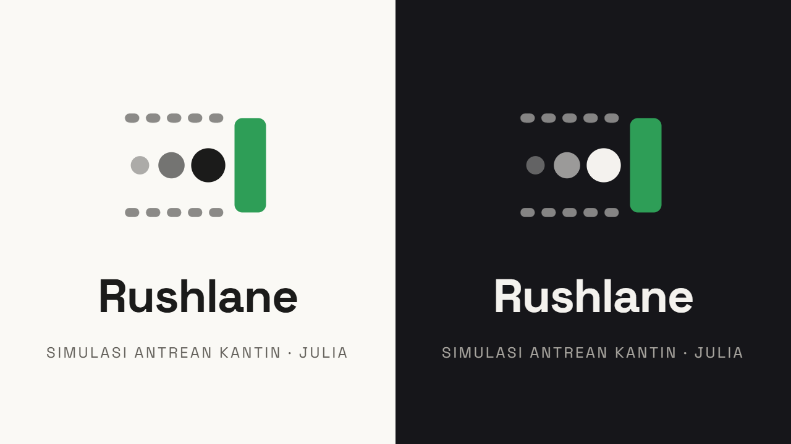

<div align="center">
  
  <h1>Rushlane: Discrete-Event Simulation for Canteen Queues</h1>
  <p><b>Simulate how a campus cafeteria queue behaves, compare one line against per-cashier lines,<br/>
  and find the smallest cashier count that meets your service targets.</b></p>

  <a href="https://github.com/nekonaru/rushlane/releases"></a>
  <a href="https://github.com/nekonaru/rushlane/actions/workflows/ci.yml"></a>
  
  
  
  
</div>

<br />

**English** | [Bahasa Indonesia](README.id.md)

> [!NOTE]
> Rushlane needs Julia 1.10 or newer. Everything else is resolved and installed automatically by Julia's package manager when you instantiate the project.

---

## Table of Contents

- [About](#about)
- [Features](#features)
- [Requirements](#requirements)
- [Installation](#installation)
- [Usage](#usage)
- [Configuration](#configuration)
- [Project Structure](#project-structure)
- [Development](#development)
- [Testing](#testing)
- [Security](#security)
- [Continuous Integration](#continuous-integration)
- [FAQ](#faq)
- [Author](#author)
- [License](#license)

---

## About

**Rushlane** is a discrete-event simulation of a campus canteen queue, built to answer one question: how many cashiers do you actually need? It models non-uniform arrival peaks (lunch rush), configurable service-time distributions, a single shared line versus one line per cashier, and customers who give up when the line is too long. Run the built-in scenarios and read a report with waiting-time percentiles, queue lengths, utilization, expected lost sales, and a recommendation.

> _"Short lines, full counters, no guessing."_

---

## Features

### Simulation engine

| Feature | Description |
|---------|-------------|
| **Discrete-event engine** | Hand-written min-heap event loop with arrival, service start, service done and renege events; no simulation library |
| **Non-uniform arrivals** | Nonhomogeneous Poisson process with per-bin rates (default 15 minutes), plus a global scale factor for rush days (for example exams) |
| **Configurable services** | Per-type service distributions (`lognormal`, `gamma`, `exponential`, `normal`, `constant`) with mean and coefficient of variation |
| **Two queue modes** | Single shared FIFO line, or one line per cashier with shortest-line selection |
| **Balking** | Customers refuse to join when too many are already waiting |
| **Reneging** | Waiting customers leave after their exponential patience runs out |
| **Cashier shifts** | Optional per-window cashier counts (for example 2 in the morning, 5 at lunch) |

### Analysis and reporting

| Feature | Description |
|---------|-------------|
| **Replication** | Configurable replications (default 200) with a fixed seed; means with 95% t-based confidence intervals |
| **Erlang C validation** | Built-in M/M/c formulas used to validate the steady-state engine |
| **Optimizer** | Finds the smallest cashier count that meets your SLA (P90 wait, abandon rate) and compares daily costs (wages vs lost sales) |
| **One-command report** | `julia --project=. scripts/rushlane.jl` writes a Markdown report, CSV exports and three figures into `out/` |
| **Visualization** | Queue length over the day, waiting-time histogram, and wait/abandon versus cashier count |
| **Reproducible** | Seed-controlled RNG, common random numbers across scenarios, pinned dependency ranges in `Project.toml` |

---

## Requirements

| Dependency | Minimum Version | Notes |
|------------|-----------------|-------|
| **Julia** | 1.10 | LTS. Any newer 1.x also works |
| **Git** | any recent | to clone and update the repository |

> [!TIP]
> No Julia yet? The easiest path is the official installer from https://julialang.org/downloads/. On Windows, `winget install Julia` works as well.

### Never used a terminal? Start here

<details><summary><b>Opening a terminal</b></summary>

**Windows:** press the Start key, type `powershell`, press Enter.

**macOS:** press `Cmd + Space`, type `terminal`, press Enter.

**Linux (GNOME):** press `Ctrl + Alt + T`.

</details>

---

## Installation

### Option A: Add it to a Julia environment (quickest)

1. Open a terminal and start Julia:

   ```bash
   julia
   ```

2. Add Rushlane directly from GitHub:

   ```julia
   using Pkg
   Pkg.add(url="https://github.com/nekonaru/rushlane.git")
   ```

3. Verify it loads:

   ```julia
   using Rushlane
   ```

### Option B: Build from source (for development / to read or change the code)

#### 1. Get the code

<details><summary><b>I have Git installed</b></summary>

```bash
git clone https://github.com/nekonaru/rushlane.git
cd rushlane
```

</details>

<details><summary><b>I don't have Git</b></summary>

1. Go to https://github.com/nekonaru/rushlane
2. Click **Code**, then **Download ZIP**
3. Extract it and open a terminal inside the extracted folder

</details>

#### 2. Install dependencies and verify

> [!IMPORTANT]
> This resolves and downloads compatible package versions from the registry. Requires network access the first time.

```bash
julia --project=. -e 'using Pkg; Pkg.instantiate()'
julia --project=. -e 'using Rushlane; println("Rushlane loaded")'
```

#### 3. Run the test suite

```bash
julia --project=. -e 'using Pkg; Pkg.test()'
```

---

## Usage

### First launch

1. Install the project (see above).
2. Generate the full report with the bundled example configuration:

   ```bash
   julia --project=. scripts/rushlane.jl
   ```

3. Open `out/report.md` in any Markdown viewer. Figures and CSV exports live next to it.

### Everyday use

- **Measure your canteen.** Edit `config/kantin_default.toml`: count arrivals every 15 minutes for a week, stopwatch the service times, then replace `rates_per_hour` and the service means.
- **Try a rush day.** Set `[arrivals] scale = 1.2` for a 20% busier day without touching the profile.
- **Compare queue modes.** Switch `[queue] mode` between `single` and `per_server` and rerun.
- **Model lunch-only staffing.** Add `[[shifts]]` blocks, for example 2 cashiers before 11:30, 5 during lunch, 2 afterward.
- **Ask your own question.** Change `[sla]` to your targets; the report tells you the cheapest cashier count that meets them.

```bash
julia --project=. scripts/rushlane.jl path/to/my_canteen.toml --out out/my_report
```

---

## Configuration

All configuration lives in one TOML file (see `config/kantin_default.toml`, commented in Indonesian). Key settings:

| Section | Keys | What they control |
|---------|------|-------------------|
| `[sim]` | `open`, `close` | Simulation window, HH:MM |
| `[sim]` | `replications`, `seed` | Replication count and base seed |
| `[arrivals]` | `bin_minutes`, `rates_per_hour` | Per-bin customers per hour, from opening time |
| `[arrivals]` | `scale` | Global multiplier (1.0 = normal, 1.2 = exam week) |
| `[service.*]` | `share`, `dist`, `mean_seconds`, `cv` | Service time distribution per customer type |
| `[queue]` | `mode` | `single` (one line) or `per_server` (one line per cashier) |
| `[behavior]` | `balk_queue_length`, `patience_mean_minutes` | Balking threshold, expected patience |
| `[servers]` | `count` | Constant cashier count |
| `[[shifts]]` | `from`, `to`, `count` | Optional per-window cashier counts |
| `[sla]` | `p90_wait_minutes`, `max_abandon_percent` | Service targets used by the optimizer |
| `[cost]` | `cashier_per_hour`, `lost_customer_cost` | Daily cost comparison inputs |
| `[report]` | `max_servers` | Highest cashier count evaluated (default 8) |

---

## Project Structure

```
rushlane/
├── Project.toml              # package definition, dependencies, compat bounds
├── LICENSE                   # MIT
├── README.md                 # this file (English)
├── README.id.md              # Bahasa Indonesia
├── assets/                   # logo mark, logo variants, banner
├── config/
│   └── kantin_default.toml   # example canteen profile, commented (Indonesian)
├── src/
│   ├── Rushlane.jl           # module entry point
│   ├── config.jl             # TOML parsing and validation
│   ├── arrivals.jl           # nonhomogeneous Poisson arrival generator
│   ├── engine.jl             # hand-written discrete-event engine (min-heap)
│   ├── metrics.jl            # per-replication metrics and 95% CIs
│   ├── analytic.jl           # Erlang C for steady-state validation
│   ├── optimize.jl           # SLA search and cost curve
│   ├── plots.jl              # CairoMakie figures
│   └── report.jl             # Markdown report and CSV exports
├── scripts/
│   ├── rushlane.jl           # one-command report generator
│   └── check_coverage.jl     # coverage gate used by CI
├── test/
│   └── runtests.jl           # test suite
├── docs/
│   └── model.md              # modeling decisions and field-measurement guide
└── .github/workflows/
    └── ci.yml                # tests (Julia 1.10 and 1.x), coverage gate, secret scan
```

---

## Development

### Regenerate the example report

1. Change `config/kantin_default.toml` or add a new profile under `config/`.
2. Run `julia --project=. scripts/rushlane.jl config/kantin_default.toml --out out/`.
3. Open `out/report.md` and check the numbers against your expectations.

### Add a new service-time distribution

1. Add the `dist` name to `SUPPORTED_DISTS` in `src/config.jl`.
2. Add a branch to `sample_service` in `src/engine.jl`.
3. Add a test in `test/runtests.jl` that samples the new distribution and checks its mean.

### Change the simulation horizon

1. Set new `open` and `close` values in the TOML file.
2. Adjust `rates_per_hour` so its entry count equals `ceil((close - open) / bin_minutes)`. The loader validates this and fails loudly otherwise.

> [!WARNING]
> The `out/` directory is generated. Never commit its contents; it is gitignored.

---

## Testing

```bash
julia --project=. -e 'using Pkg; Pkg.test()'
```

| Check | Requirement |
|-------|-------------|
| Test suite | all tests pass on Julia 1.10 and 1.x |
| Line coverage | >= 60% over `src/`, enforced in CI (`scripts/check_coverage.jl`) |
| Invariants | event times never decrease; no customer served twice (checked with `check_invariants = true`) |
| Validation | simulation matches Erlang C within 3% in M/M/c steady state |

---

## Security

Rushlane validates every TOML configuration value at the boundary (types, ranges, supported distribution names, bin count consistency), runs only registered Julia packages with dependency ranges pinned in `Project.toml`, and scans for secrets in CI. Report vulnerabilities privately through the process in [`SECURITY.md`](SECURITY.md), not by opening a public issue.

> [!NOTE]
> Rushlane has no network services, no accounts and stores no personal data. The main risks are hostile configuration files and resource exhaustion; both are bounded (input caps in `load_config`, fixed simulation horizon).

---

## Continuous Integration

| Workflow | Purpose |
|----------|---------|
| `.github/workflows/ci.yml` | Runs the test suite on Julia 1.10 and 1.x, enforces the 60% coverage gate, scans for secrets |

Branch protection on `main` requires CI to pass before a pull request can merge.

---

## FAQ

<details><summary><b>Do I need to know Julia to use Rushlane?</b></summary>

No. You edit a TOML file and run one command. All outputs are a Markdown report, three figures and CSV files.

</details>

<details><summary><b>How do I use data from my own canteen?</b></summary>

Count customers per 15-minute bin for a few days and stopwatch service times, then put those numbers in `rates_per_hour` and the `[service.*]` tables. `docs/model.md` explains the measurement protocol.

</details>

<details><summary><b>Why 200 replications?</b></summary>

Randomness makes single runs noisy. With 200 replications, the reported means have tight 95% confidence intervals, so the cashier count recommendation is stable. Lower it in `[sim] replications` while experimenting, raise it before deciding.

</details>

<details><summary><b>Why do different cashier counts use the same random seeds?</b></summary>

Common random numbers pair the arrival stream and the service-time stream across scenarios, so the comparison is paired and fair. Note that this pairs the draws, not the exact outcomes: once balking or reneging decisions differ between scenarios, the paths diverge from there.

</details>

<details><summary><b>My simulated day has customers still in line at closing time. What happens to them?</b></summary>

Customers still in line or mid-service at closing are excluded from waiting-time statistics; only customers who completed service before closing count. Increase `replications` to tighten the estimates.

</details>

<details><summary><b>Can Rushlane model paying by QRIS or cashier break times?</b></summary>

Payment methods are out of scope. Break times can be approximated with `[[shifts]]` by lowering cashier counts in those windows.

</details>

---

## Author

<div align="center">

| [](https://github.com/nekonaru) |
|:---:|
| **Nicolas Dwi Dharma** |
| [github.com/nekonaru](https://github.com/nekonaru) |

</div>

---

## License

Distributed under the **MIT License**. See [`LICENSE`](LICENSE) for more information.
